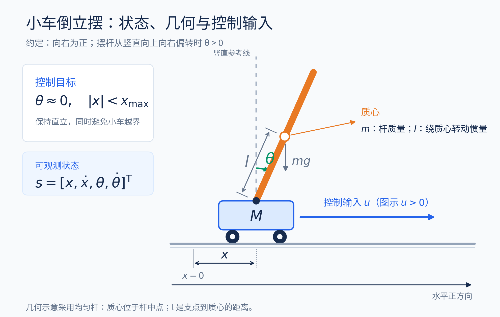
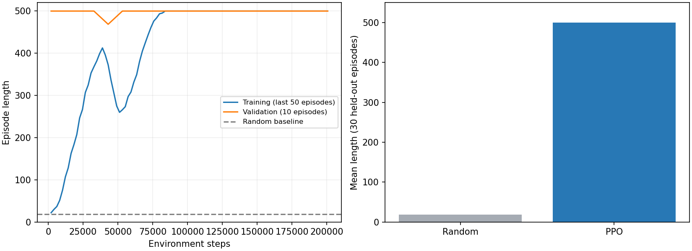
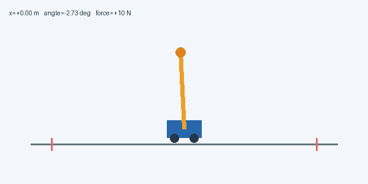

# 用 PPO 建立小车倒立摆平衡基线

[系列目录](README.md) · 本篇为系列起点 · [下一篇：只改动作表达：让 PPO 输出连续推力](02_只改动作空间让推力连续.md)

> 本文是“小车倒立摆 PPO 逐步优化”系列的一篇。公式与参数对应现有实现，表格来自已保存的实验结果；动画为真实仿真轨迹。需要支持 LaTeX 的 Markdown 阅读器。图片与动图统一位于本系列的 `assets` 文件夹，请与文章一起保留。


## 本篇对应的独立代码

配套脚本：[01_discrete_ppo.py](code/01_discrete_ppo.py)。它内含本篇所需的环境、网络、PPO/GAE、训练、评估和动画逻辑，不导入原项目包。安装 [依赖](code/requirements.txt) 后，在项目根目录运行：

```bash
# 单文件从头训练，不需要先运行其他篇
python3 PPO优化系列/code/01_discrete_ppo.py

# 加载本篇已发布模型，只做评估并生成动画
python3 PPO优化系列/code/01_discrete_ppo.py --evaluate PPO优化系列/code/checkpoints/01_discrete.npz
```

默认从头训练，与本篇原实验的初始化方式一致。默认结果位于脚本旁的 `outputs` 子目录；完整参数与模式说明见 [独立代码说明](code/README.md)。后文保留的 `python3 -m cartpole_pg...` 命令是原项目模块形式，单文件运行使用本节入口。

## 本篇只建立一件事：能从交互中学到平衡

本系列从最简单的左右固定推力出发。先把物理环境、策略梯度、Actor–Critic、GAE 和 PPO 的联系说明白，并得到可复现的平衡基线。连续动作、位置回归和抗扰训练留到后篇，本篇不提前把这些能力加入控制器。

| 项目 | 本篇起点 |
|---|---|
| 观测 | $[x,\dot x,\theta,\dot\theta]$ |
| 动作 | 左 −10 N / 右 +10 N |
| 奖励 | 每步 +1，包括触发失败的那一步 |
| 每步时长 | 0.02 s |
| 训练与评估回合上限 | 500 步，即 10 s |
| 网络与算法 | 两个 64–64 tanh 网络，PPO + GAE |

## 仿真对象：一个有执行器限制的不稳定系统

### 状态、动作和力学模型



**插图：小车倒立摆的结构示意。** 小车只能接受水平力，摆杆没有独立驱动器；通过移动支点来间接控制摆杆。

基础状态为：

$$
s=[x,\dot x,\theta,\dot\theta]^{\mathsf T}.
$$

其中 $\theta=0$ 表示竖直向上，向右倾斜为正。小车质量 $M=1$ kg，摆杆质量 $m=0.1$ kg，支点到质心距离 $l=0.5$ m，重力 $g=9.8$ m/s²。均匀杆绕质心的转动惯量为：

$$
I=\frac13ml^2.
$$

总水平力记作 $f$，动力学满足：

$$
\begin{bmatrix}
M+m & ml\cos\theta\\
ml\cos\theta & I+ml^2
\end{bmatrix}
\begin{bmatrix}\ddot x\\\ddot\theta\end{bmatrix}
=
\begin{bmatrix}
f+ml\sin\theta\,\dot\theta^2\\
mgl\sin\theta
\end{bmatrix}.
$$

代码使用该模型的等价解析形式计算加速度，再用步长 $\Delta t=0.02$ s 的显式 Euler 积分更新状态。没有摩擦、传感噪声或执行器延迟。

真正失败条件为：

$$
|x|>2.4\ \mathrm m\quad\text{或}\quad |\theta|>12^\circ.
$$

达到评估时长属于时间截断。失败动画停止在越过边界的状态，不会继续模拟摆杆落地。本文讨论的是**直立附近的平衡与位置控制**，没有实现从下垂位置摆起。

### 控制力与扰动力必须分开

正常情况下，策略决定控制力 $u_t$。扰动实验额外施加外力 $d_t$：

$$
f_t=u_t+d_t,\qquad |u_t|\le10\ \mathrm N.
$$

只有执行器输出受 ±10 N 限制。外部推力独立进入动力学，总力不再次裁剪到 ±10 N，否则会错误地削弱外部扰动。

连续力可以每一步取任意实数，但每 20 ms 才更新一次。它是连续**动作值**、离散**控制时刻**，并不自动保证时间上的平滑。
## 从运动方程到仿真循环

在直立附近，$\sin\theta\approx\theta$、$\cos\theta\approx1$。令 $D=(M+m)(I+ml^2)-m^2l^2$，有：

$$
\ddot\theta\approx\frac{(M+m)mgl}{D}\theta-\frac{ml}{D}u.
$$

倾角前的系数为正，说明不施力时微小偏角会被放大；控制力通过支点加速度影响摆杆。策略需要同时看到倾角和运动趋势：相同倾角、不同角速度，所需推力未必相同。

显式 Euler 使用旧状态计算加速度，再更新：$x_{t+1}=x_t+\Delta t\dot x_t$、$\dot x_{t+1}=\dot x_t+\Delta t\ddot x_t$，角度同理。它是数值近似，时间步长与终止条件是实验定义的一部分。

## 从 REINFORCE 到 PPO：它们都在学习策略，区别在哪里？

在展开 PPO 之前，先把它与最基础的策略梯度方法 **REINFORCE** 放在一起看。两者都不是直接规定“摆杆向右就必须向右推”，而是学习一个带参数的动作分布 $\pi_\vartheta(a|s)$，根据交互得到的奖励调整动作概率。PPO 延续了策略梯度的思路，重点改进了**如何评价动作，以及如何用一批数据更新策略**。

本节把 REINFORCE 指作常见的“完整回合采样 + 蒙特卡洛回报加权”的基础实现。REINFORCE 也能加入状态基线，不能把“有没有价值网络”当成它与 PPO 的唯一分界。方法背景可参见 [Williams 的 REINFORCE 原论文](https://doi.org/10.1007/BF00992696) 与 [PPO 原论文](https://arxiv.org/abs/1707.06347)。

### REINFORCE：经历一段完整结果，再提高好动作的概率

假设从时刻 $t$ 开始，直到回合结束时刻 $T$，实际获得的折扣回报为：

$$
G_t=\sum_{k=t}^{T-1}\gamma^{k-t}r_k.
$$

对于回合起点的折扣目标 $J=\mathbb E[\sum_t\gamma^t r_t]$，基础 REINFORCE 可以用下式估计梯度：

$$
\hat g_{\mathrm{RF}}=
\frac{1}{N}\sum_{i=1}^{N}\sum_{t=0}^{T_i-1}
\gamma^t\nabla_\vartheta\log\pi_\vartheta(a_t^{(i)}|s_t^{(i)})
\bigl(G_t^{(i)}-b(s_t^{(i)})\bigr).
$$

这里 $N$ 是采样回合数，$b(s_t)$ 是可选的、与当前动作无关的状态基线，计算策略梯度时把它视为固定权重。取 $b=0$，就是直接用实际回报加权；取 $b\approx V^\pi$，就是比较“实际结果比预期好多少”。外层 $\gamma^t$ 对应上述严格的折扣目标；常见教程也有省略它的实现，不能不区分目标就把所有写法视为完全相同。

公式的直观含义是：

- $\nabla\log\pi$ 给出提高这个动作概率的参数方向。
- $G_t-b(s_t)>0$ 时，沿这个方向推动；小于 0 时，反向推动。
- 最后由优化器按学习率更新参数，不是把回报直接变成推力大小。

在倒立摆中，一次左推之后还能存活多久，不只由这次动作决定，还受后续动作和初始状态影响。因此，**单次完整回报包含较大的随机波动**。REINFORCE 的概念很清楚，却往往需要较多轨迹来抵消这种波动。状态基线有助于降低方差，但不能保证消除所有波动。

需要注意，本篇的奖励始终为每步 +1。没有基线时，一次最终失败的轨迹也可能给动作正回报；它并不会自动把所有失败前动作标成“负样本”。在期望意义上，高回报动作得到更强的推动，学习才逐渐发生。

### PPO：先估计相对表现，再谨慎地重复利用本批数据

本项目的 PPO 在上述思路上采用了两组设计：

**第一组是动作评价。** 策略网络 Actor 选择动作，价值网络 Critic 预测回报；利用价值预测和实际奖励，通过 GAE 得到优势估计 $\hat A_t$。这样可以按固定长度采样，不必等每个回合都自然结束。代价是引入价值预测与自举的近似误差，GAE 用 $\lambda$ 调节这种折中。**Actor–Critic 和 GAE 不是 PPO 独有的发明，也可以与其他策略梯度方法配合。**

**第二组是策略更新。** 数据由采样时的旧策略生成。优化器更新参数后，同一个动作在新策略下的概率会变化，于是 PPO 保存旧概率，构造：

$$
\rho_t=\frac{\pi_\vartheta(a_t|s_t)}{\pi_{\mathrm{old}}(a_t|s_t)}.
$$

再使用裁剪代理目标：

$$
L^{\mathrm{CLIP}}=
\mathbb E_t\!\left[
\min\!\left(
\rho_t\hat A_t,
\operatorname{clip}(\rho_t,1-\epsilon,1+\epsilon)\hat A_t
\right)\right].
$$

例如某个动作的 $\hat A_t=1$，裁剪参数 $\epsilon=0.2$：当概率比从 1 增加到 1.2，目标会提高；继续增加到 1.5 时，这个样本的裁剪目标仍只取 1.2，削弱了继续提高其概率的直接激励。优势为负时，目标也会对朝有利方向过度降低动作概率的情况作相应处理。

这使 PPO 能对同一批近期数据进行有限轮小批量优化，而不只是直接反复优化旧轨迹上的原始回报加权目标。不过，**裁剪不是硬约束**：其他样本、熵奖励以及共享参数的影响仍可能让概率比越过区间。PPO 通常仍按 on-policy 算法使用，有限轮利用当前采样批次，不等于可以任意重用很久以前的数据。

### 放在一起比较

| 比较项 | 基础 REINFORCE | 本项目采用的 PPO-Clip |
|---|---|---|
| 共同目标 | 根据奖励改进动作概率分布 | 同样属于策略梯度方法 |
| 动作评价 | 完整轨迹的蒙特卡洛回报，可减去基线 | Critic + GAE 估计优势 |
| 是否必须有 Critic | 不必须；也可学习价值基线 | 本实现使用独立价值网络 |
| 采样组织 | 典型实现先采完整回合 | 8 个环境各采 256 步，跨回合边界正确处理 |
| 一批数据怎样用 | 基础做法在采样策略处估计梯度，更新后重新采样 | 保存旧概率，对 2048 个样本做 4 轮、每批 64 个样本的优化 |
| 是否处理较大的策略变化 | 原始目标没有 PPO 式裁剪，主要依靠学习率等设计 | 概率比与裁剪代理目标削弱部分过大更新的激励 |
| 主要误差或代价 | 完整回报波动较大，采样开销可能较高 | 有价值估计与代理目标近似，结构和超参数更多 |
| 动作空间 | 可以用于离散动作，也可以用于连续动作 | 同样可以用于离散或连续动作 |

这里比较的是基础 REINFORCE 与**本项目的具体 PPO 配置**，并非声称所有 REINFORCE 都只能单回合更新，或所有 PPO 都必须使用 GAE。

### 为什么本系列以 PPO 为基线？

REINFORCE 很适合用来理解“奖励如何通过动作概率影响神经网络”；PPO 则方便本系列在统一训练框架下，继续研究连续力、控制代价、目标位置和随机扰动。固定长度并行采样、价值基线和有限轮小批量更新，使后续实验具有一致的实现入口。

但算法名本身不保证控制效果。PPO 不会自动学会轻推、回到原点或抗扰：没有合适的动作表达、奖励和训练经历，这些能力仍然可能学不到。

**本篇没有在同一预算下训练 REINFORCE 对照组，因此这里是原理与实现机制的比较，不是“PPO 实测一定优于 REINFORCE”的结论。** 后文图表和动画均对应本篇的 PPO 基线。接下来依次展开优势、GAE 和裁剪目标，就能看到它们在代码中分别承担什么职责。

## 算法主线：PPO 如何把尝试变成反馈控制

**PPO（Proximal Policy Optimization，近端策略优化）是一种策略梯度强化学习算法。** 它先用当前策略与环境交互，再根据动作带来的长期回报调整策略：提高表现好于预期的动作的概率，降低表现较差的动作的概率。它的特点是通过裁剪代理目标，削弱过大的有利方向更新激励，减少一次更新破坏已有控制行为的风险；裁剪并不是严格限制策略变化的硬约束。

在本项目中，可以把学习过程理解为“观察小车和摆杆 → 尝试施力 → 记录后果 → 评价动作 → 更新策略”。Actor（策略网络）决定如何选择推力，Critic（价值网络）估计未来回报，GAE 用奖励和价值预测估计动作优势，PPO 则利用优势更新 Actor。下面分别解释动作评价与策略更新。

项目用 NumPy 实现策略网络、价值网络、反向传播和 Adam，无需 PyTorch 或 Gymnasium。两个独立网络均为 64–64 的 tanh 隐藏层：Actor 输出动作分布，Critic 输出状态价值。

### 动作要按长期后果评价

策略 $\pi_\vartheta(a|s)$ 描述当前状态下如何选择动作。训练通过交互获得奖励，并提高有利动作的概率。关键权重是优势：

$$
A^\pi(s,a)=Q^\pi(s,a)-V^\pi(s).
$$

这个公式回答的是：**在状态 $s$ 下，动作 $a$ 比当前策略通常的选择好多少？** 上标 $\pi$ 表示评价以当前策略为基础；三个量都涉及未来累计奖励，而不是仅看眼前一步。

| 量 | 从当前状态出发，如何行动？ | 评价什么？ |
|---|---|---|
| $Q^\pi(s,a)$ | 先执行指定动作 $a$，之后按策略 $\pi$ 行动 | 预计获得的未来回报 |
| $V^\pi(s)$ | 当前也按策略 $\pi$ 选择动作，之后继续遵循它 | 当前策略的平均预计回报 |
| $A^\pi(s,a)$ | 比较上述两种情况 | 指定动作比当前策略的平均选择好多少 |

#### 先固定同一个状态，理解为什么要相减

假设摆杆处于某个姿态，当前策略有一半概率左推、一半概率右推。为了便于解释，假设两个动作的未来预计回报如下；这些数字是教学示例，不是仿真实测，也不代表向右推在所有状态下都更好。

| 动作 | 当前选择概率 | 动作价值 $Q^\pi(s,a)$ |
|---|---:|---:|
| 左推 | 0.5 | 20 |
| 右推 | 0.5 | 80 |

不指定动作，继续照当前策略选，平均能得到：

$$
V^\pi(s)=\sum_a\pi(a|s)Q^\pi(s,a)
=0.5\times20+0.5\times80=50.
$$

现在问：左推值得更多地选择吗？它虽然能得到 20 分，但原来的选择方式平均能得到 50 分。增加左推的概率，会拉低平均表现，因此：

$$
A^\pi(s,\text{左})=20-50=-30.
$$

负号表示它比当前策略的平均选择差，应降低选择它的概率。右推则相反：

$$
A^\pi(s,\text{右})=80-50=30.
$$

正号表示它比平均选择好，应提高选择它的概率。这里的 30 是预计回报的差值，不是概率应增加 30%，也不是应多施加 30 N 推力。

所以，减去 $V^\pi(s)$，就是给动作设定一个参照：**这个动作，比“继续照现在的策略选”更好，还是更差？**

#### 再看不同状态：同样的回报，含义可能不同

有了上述参照，再比较不同状态就更容易理解。如果一个容易平衡的状态下，当前策略平均预计获得 100 分，那么某动作的预计回报为 20 分，优势就是 $20-100=-80$。如果一个危险状态下，当前策略平均只能得到 10 分，那么预计回报为 20 分的动作，优势却是 $20-10=10$。

两个动作的绝对回报相同，但相对于各自状态下的通常表现，评价不同。这并不是给危险状态额外加分，而是避免把状态本身的难度与动作的相对好坏混在一起。对倒立摆而言，短暂向目标反方向移动，也可能是扶正摆杆所必需的动作，不能仅按眼前的位置变化判断。

#### 不减去基线也能学习，为什么实际中仍常这样做？

策略梯度可以直接用回报作为权重，并不是必须构造优势才能学习。直接用正回报时，采样到的动作可能都会得到提高概率的更新，但在反复采样的平均意义上，高回报动作仍能获得更强的推动。

减去一个不依赖当前动作的状态基线，可以去掉部分共同的回报背景。给定状态 $s$，有：

$$
\begin{aligned}
\mathbb E_{a\sim\pi}[\nabla_\vartheta\log\pi_\vartheta(a|s)V^\pi(s)]
&=V^\pi(s)\sum_a\nabla_\vartheta\pi_\vartheta(a|s)\\
&=V^\pi(s)\nabla_\vartheta1=0.
\end{aligned}
$$

因此，在作为固定权重、停止梯度等条件下，减去这种基线不会改变策略梯度的期望，却通常有助于降低采样波动。价值函数是常用基线，但并非在所有情况下都是最小方差基线；PPO 的裁剪、有限样本优势标准化和近似价值估计也使实际更新不同于理想无偏梯度。

在本项目中，没有单独训练 $Q$ 网络。Critic 估计 $V$，再结合实际奖励，通过 GAE 计算优势估计 $\hat A_t$。Actor 使用这个固定估计作为动作评价，损失不会通过优势反传到 Critic。

**GAE（Generalized Advantage Estimation，广义优势估计）是估计动作优势的方法。** 它先比较“行动前预计的回报”与“本步实际奖励加下一状态预计回报”，得到一步的预测差 $\delta_t$。但动作的后果可能过几步才显现，因此 GAE 再把后续多步的预测差加权累加，越远的步骤权重越小：

$$
\hat A_t=\delta_t+\gamma\lambda\delta_{t+1}+(\gamma\lambda)^2\delta_{t+2}+\cdots.
$$

其中 $\lambda=0$ 时只看一步；$\lambda$ 接近 1 时考虑更多后续反馈，通常也会带来更大的采样波动。它在依赖 Critic 的短期预测与利用更长的实际奖励信息之间折中。对倒立摆来说，这有助于评价那些眼前让小车偏离目标、却有利于后续扶正的动作。**GAE 负责估计动作好多少，PPO 根据这个估计调整策略。**

实际计算用反向递推，不需要逐项展开。本系列实现中，Critic 的 TD 残差和 GAE 递推为：

$$
\delta_t=r_t+\gamma b_tV(s_{t+1})-V(s_t),
$$

$$
\hat A_t=\delta_t+\gamma\lambda c_t\hat A_{t+1}.
$$

这里 $b_t$ 控制价值自举，$c_t$ 控制是否沿同一回合继续递推。真正失败时，两者均为 0；时间截断时仍可用最终状态自举，但递推不能跨到重置后的新回合。采样批次末端也用下一状态价值自举。

GAE 用不同长度的奖励信息形成优势估计，调节偏差与方差；方法来源见 [GAE 原论文](https://arxiv.org/abs/1506.02438)。项目取 $\lambda=0.95$，价值目标为 $\hat A_t+V_{\mathrm{old}}(s_t)$。

### 限制更新幅度，避免一次更新破坏已有控制

保存采样时的旧动作概率，构造概率比：

$$
\rho_t(\vartheta)=\exp\bigl(\log\pi_\vartheta(a_t|s_t)-\log\pi_{\mathrm{old}}(a_t|s_t)\bigr).
$$

PPO 优化裁剪代理目标：

$$
L^{\mathrm{CLIP}}=\mathbb E\left[\min\left(\rho_t\hat A_t,
\operatorname{clip}(\rho_t,1-\epsilon,1+\epsilon)\hat A_t\right)\right].
$$

它削弱已经朝有利方向改变很多的样本的进一步更新激励，使一批数据可以进行有限轮小批量优化。它不是严格的概率比约束，也不保证每次更新都提高真实回报。方法来源见 [PPO 原论文](https://arxiv.org/abs/1707.06347)。

本实现最小化：

$$
\mathcal L=-L^{\mathrm{CLIP}}+\frac{c_V}{2}\mathbb E[(V-y)^2]-c_H\mathbb E[H(\pi)].
$$

旧对数概率、优势、价值目标均固定。只对 Actor 使用的优势做标准化，不把标准化后的优势用于价值目标。

| 配置 | 离散与连续初始训练 | 位置与扰动微调 |
|---|---:|---:|
| 环境数 × 每环境采样步数 | 8 × 256 | 8 × 256 |
| 每批样本 | 2048 | 2048 |
| 更新轮数 / 小批量大小 | 4 / 64 | 4 / 64 |
| Adam 学习率 | $3\times10^{-4}$ | $10^{-4}$ |
| $\gamma$ / $\lambda$ | 0.99 / 0.95 | 0.995 / 0.95 |
| 裁剪参数 $\epsilon$ | 0.2 | 0.2 |
| $c_V$ / $c_H$ | 0.5 / 0.01 | 0.5 / 0.01 |
| 梯度范数上限 | 0.5 | 0.5 |

训练随机采样动作，展示与评估使用确定性策略。不能把训练中的探索抖动和最终执行策略的抖动混为一谈。
## 为什么奖励能指导网络：策略梯度的来由

一条轨迹的概率是策略动作概率与环境转移概率的乘积。当动力学不依赖网络参数时，对轨迹对数概率求导只留下 $\sum_t\nabla\log\pi_\vartheta(a_t|s_t)$。利用对数导数技巧，就能用采样回报为这些梯度加权，而无需对物理仿真求导。

如果严格优化回合起点的折扣目标 $J=\mathbb E[\sum_t\gamma^t r_t]$，reward-to-go 形式包含外层 $\gamma^t$：

$$
\nabla J=\mathbb E[\sum_t\gamma^t\nabla\log\pi_\vartheta(a_t|s_t)G_t].
$$

本项目采用常见的均匀样本 PPO 代理目标，不能将其直接称作上述目标的精确无偏梯度。PPO 是基于旧策略状态分布的局部代理优化。

离散 Actor 输出两个 logits，通过 Softmax 得到左右概率；训练按概率采样，评估取最大概率动作。Critic 不告诉 Actor“正确动作是左还是右”，而是提供价值参照，结合奖励估计优势。

## 第一阶段：能撑住，但为什么不停左右推？

离散策略只有两个动作：

$$
u_t\in\{-10,+10\}\ \mathrm N,
$$

奖励为每步 1。这个目标只关心存活时间。只要没有越界，在中心附近平稳控制与不断左右纠正都能得到相同奖励。

更直接的问题是：没有“轻推”或“零推力”。即使摆杆只需要很小的纠正，策略也必须选择 ±10 N。左右动作切换时，推力一次变化 20 N。



**插图：离散种子 0 的实际训练曲线。** 蓝线是最近 50 个训练回合平均长度；橙线是确定性验证策略的回合长度。两者动作选择方式不同，因此验证可以很早达到上限，而探索中的训练回合仍较短。

两个训练种子各运行 200,704 个交互步，最终各自 30 个独立评估回合均达到 500 步。种子 0 的平均动作切换次数为 384.2，倾角 RMS 为 0.697°。

这说明策略已学会平衡，但存活上限掩盖了控制品质的差异。接下来需要改变动作的表达能力。



**动图：离散基线。** 推力只能在两个固定值之间切换。动画是训练完成后的确定性策略，不是训练时随机探索的录像。

## 复现与交接

在项目根目录运行：

```bash
OPENBLAS_NUM_THREADS=1 MPLCONFIGDIR=/tmp/cartpole-mpl python3 -m cartpole_pg.simulation --seed 0 --output results/seed0
```

学习率 $3\times10^{-4}$、$\gamma=0.99$、$\lambda=0.95$，训练 200,704 步。保存的 `policy.npz` 来自验证集选择，`policy_final.npz` 是最终更新；独立评估 30 回合不参与选择。完整配置见本篇 PPO 表格及 [代码](../cartpole_pg/simulation.py)。

下一篇只解决动作粒度：保留 PPO、动力学和存活奖励，把两个力改为有界连续力。此处的满分不能当成下一篇已经完成的证据。

## 理论来源与实现依据

- [REINFORCE 原论文](https://doi.org/10.1007/BF00992696)：回报加权的策略梯度与基线思想。
- [PPO 原论文](https://arxiv.org/abs/1707.06347)：裁剪代理目标与多轮小批量更新的方法背景。
- [GAE 原论文](https://arxiv.org/abs/1506.02438)：用价值函数与多步残差估计优势的方法背景。
- [项目完整优化记录](../从抖动到抗扰：小车倒立摆PPO优化实录.md)：完整过程及数据入口。

本文模型参数、奖励与实验结论来自本项目实现和数据，不能从方法论文直接推出。有限回合成功不等于全局稳定性证明。

[系列目录](README.md) · 本篇为系列起点 · [下一篇：只改动作表达：让 PPO 输出连续推力](02_只改动作空间让推力连续.md)
