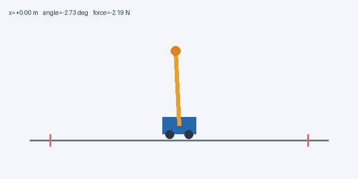

# 只改动作表达：让 PPO 输出连续推力

[系列目录](README.md) · [上一篇：用 PPO 建立小车倒立摆平衡基线](01_用PPO建立倒立摆平衡基线.md) · [下一篇：继承连续动作：用奖励表达平滑与用力代价](03_在连续控制中加入平滑奖励.md)

> 本文是“小车倒立摆 PPO 逐步优化”系列的一篇。公式与参数对应现有实现，表格来自已保存的实验结果；动画为真实仿真轨迹。需要支持 LaTeX 的 Markdown 阅读器。图片与动图统一位于本系列的 `assets` 文件夹，请与文章一起保留。


## 本篇对应的独立代码

配套脚本：[02_continuous_ppo.py](code/02_continuous_ppo.py)。它内含本篇所需的环境、网络、PPO/GAE、训练、评估和动画逻辑，不导入原项目包。安装 [依赖](code/requirements.txt) 后，在项目根目录运行：

```bash
# 单文件从头训练，不需要先运行其他篇
python3 PPO优化系列/code/02_continuous_ppo.py

# 加载本篇已发布模型，只做评估并生成动画
python3 PPO优化系列/code/02_continuous_ppo.py --evaluate PPO优化系列/code/checkpoints/02_continuous.npz
```

默认从头训练，与本篇原实验的初始化方式一致。默认结果位于脚本旁的 `outputs` 子目录；完整参数与模式说明见 [独立代码说明](code/README.md)。后文保留的 `python3 -m cartpole_pg...` 命令是原项目模块形式，单文件运行使用本节入口。

## 本篇的唯一主题：连续动作表达

上一篇得到能维持直立的离散 PPO。本篇继承动力学、轨道和倾角边界、20 ms 控制周期、Actor–Critic、GAE 与 PPO，只研究如何表示更细的推力。**主实验保持每步奖励 $r=1$，先不加入平滑奖励。**

| 配置 | 上一篇 | 本篇 |
|---|---|---|
| 力 | 只能 ±10 N | $10\tanh z$，允许中间值 |
| Actor 输出 | 两个 logits | 一个均值与可学习全局 logstd |
| 奖励 | +1 | +1，保持不变 |
| Critic、PPO、GAE | 使用 | 继续使用 |
| 学习率 / 折扣 | 3e−4 / .99 | 保留 |

实际代码统一采用五维连续版本观测，提前包含上一控制力；本篇存活奖励不依赖它，它不是必需信息。输入层因此从四维变为五维。这是为下一篇统一接口的实现安排，因此本实验也不是只改一个张量的严格单变量对照。

继承的物理参数为：小车 1 kg、杆 0.1 kg、半杆长 0.5 m、重力 9.8 m/s²，均匀杆、无摩擦，20 ms 显式 Euler；失败条件为绝对位置超过 2.4 m 或倾角超过 12°。这些是各篇统一的仿真约定，不是学习出来的参数。

## 本篇继承的学习机制

Actor 根据观测产生动作分布，Critic 预测未来折扣回报。训练先固定旧策略采样，再计算优势，最后对同一批数据做有限轮 PPO 更新。优势 $\hat A_t>0$ 表示采样动作比该状态下的通常表现好，负值则相反；它不是动作的监督标签。

GAE 先计算 $\delta_t=r_t+\gamma b_tV(s_{t+1})-V(s_t)$，再反向递推 $\hat A_t=\delta_t+\gamma\lambda c_t\hat A_{t+1}$。$\lambda=0.95$；真正失败不自举，时间截断用重置前的最终状态自举，但两种回合结束都停止优势跨回合递推。

PPO 用 $\rho_t=\exp(\log\pi_{new}-\log\pi_{old})$ 和裁剪目标更新 Actor：

$$
L=\mathbb E[\min(\rho_t\hat A_t,\operatorname{clip}(\rho_t,0.8,1.2)\hat A_t)].
$$

裁剪削弱过大的有利方向更新激励，不是策略变化的严格硬约束。价值目标为旧价值加原始优势，Actor 的优势可标准化；旧概率、优势和价值目标都停止梯度。总损失包含价值回归与熵正则。

各篇默认保留独立 64–64 tanh Actor/Critic、8 个环境 × 256 步采样、4 轮更新、小批量 64、价值系数 0.5、熵系数 0.01、梯度范数上限 0.5。具体学习率、折扣与评估时长在各篇配置表中注明。
### Actor 输出的是分布参数，不是固定动作标签

连续 Actor 输出无界均值 $\mu_\vartheta(s)$，并学习一个全局标准差 $\sigma=\exp(\eta)$。训练采样：

$$
z_t=\mu_\vartheta(s_t)+\sigma\varepsilon_t,\qquad\varepsilon_t\sim\mathcal N(0,1),
$$

随后执行：

$$
u_t=10\tanh(z_t).
$$

例如，$z_t=0.2$ 对应约 1.97 N，而非必须选择 10 N。训练探索不同力的后果；评估时直接用 $10\tanh(\mu)$。这是一种确定性执行约定，不等于非线性变换后动作分布的数学期望。

代码中的 `logstd` 初值为 −0.7，优化后限制在 [−4, 0.5]。$\sigma$ 描述潜变量 $z$ 的尺度，不是执行力的标准差。

### tanh 限幅需要修正动作概率

设 $u=U\tanh z$，$U=10$，则：

$$
\frac{du}{dz}=U(1-\tanh^2z).
$$

由变量变换可得：

$$
\log\pi(u|s)=\log\mathcal N(z;\mu,\sigma^2)
-\log\left[U(1-\tanh^2z)\right].
$$

实现保存采样时的 $z$，避免接近饱和时反求 `atanh`。为避免浮点下溢，使用：

$$
\log(1-\tanh^2z)=2\left(\log2-z-\operatorname{softplus}(-2z)\right).
$$

同一动作的新旧概率比中 Jacobian 会抵消，但正确的动作密度对熵和诊断仍然重要。本实现用重参数化蒙特卡洛方法估计**有界动作分布**的熵并计算梯度；微分熵可能为负。
## 高斯探索怎样变成可学习的推力

潜变量密度为：

$$
\log p(z|s)=-\frac12\left(\frac{z-\mu}{\sigma}\right)^2-\log\sigma-\frac12\log(2\pi).
$$

对一个已经采样、在 PPO 更新中保持固定的 $z$：

$$
\frac{\partial\log p}{\partial\mu}=\frac{z-\mu}{\sigma^2},\qquad
\frac{\partial\log p}{\partial\log\sigma}=\frac{(z-\mu)^2}{\sigma^2}-1.
$$

这些导数乘上优势和 PPO 概率比，形成策略更新。正优势倾向提高这个样本的密度，但共享网络参数会同时影响其他状态和动作，不能理解成独立移动某个概率格子。

$\tanh$ 接近两端时 $du/dz$ 很小，推力趋近饱和；均值相同而标准差不同，会产生不同探索行为。只把高斯样本硬裁剪到 ±10 N，却继续按未裁剪的高斯计算动作概率，会造成分布不一致；本实现用可逆的 tanh 变量变换处理区间内部的密度。

训练要区分两种梯度：PPO 的对数概率对已保存样本求导，样本固定；重参数化熵估计则通过新采样 $z=\mu+\sigma\varepsilon$ 对分布参数求导。不能把两种计算路径混用。

## 不改变奖励，动作是否已经平滑了？

| 指标，30 回合均值 | 离散基线，种子 0 | 连续存活奖励，种子 0 |
|---|---:|---:|
| 回合长度 | 500 | 500 |
| 倾角 RMS | 0.697° | 0.229° |
| 推力 RMS | 10.000 N | 0.145 N |
| 相邻推力变化 RMS | 17.542 N | 0.024 N |



**动图：本篇仅存活奖励的连续策略。** 不使用下一篇的平滑奖励，避免把不同改动的效果混在一起。

指标先在每回合计算 RMS，再取回合平均；力变化不跨越重置边界。离散基线训练 200,704 步，连续版本 401,408 步，因此结果说明最终控制行为更细腻，不说明样本效率更高。局部平衡只需很小推力，连续动作终于能表达这种行为；它仍不保证任意初始状态都平滑或稳定。

## 复现与继承关系

```bash
OPENBLAS_NUM_THREADS=1 MPLCONFIGDIR=/tmp/cartpole-mpl python3 -m cartpole_pg.continuous --reward survival --seed 0 --output results/continuous_survival_seed0
```

实现见 [连续策略](../cartpole_pg/continuous.py)，实测数据见 [本篇指标](../results/continuous_survival_seed0/metrics.json)。本阶段从头初始化连续网络，**继承的是上篇模型、算法和目标设计，不是直接加载离散权重**，因为 Actor 输出分布已改变。

从本篇交给下一篇的是：有界连续力、正确的动作密度、相同的五维接口和既有 PPO 更新机制。下一篇再单独研究奖励是否能表达少用力和少跳变。

## 理论来源与实现依据

- [PPO 原论文](https://arxiv.org/abs/1707.06347)：裁剪代理目标与多轮小批量更新的方法背景。
- [GAE 原论文](https://arxiv.org/abs/1506.02438)：用价值函数与多步残差估计优势的方法背景。
- [项目完整优化记录](../从抖动到抗扰：小车倒立摆PPO优化实录.md)：完整过程及数据入口。

本文模型参数、奖励与实验结论来自本项目实现和数据，不能从方法论文直接推出。有限回合成功不等于全局稳定性证明。

[系列目录](README.md) · [上一篇：用 PPO 建立小车倒立摆平衡基线](01_用PPO建立倒立摆平衡基线.md) · [下一篇：继承连续动作：用奖励表达平滑与用力代价](03_在连续控制中加入平滑奖励.md)
