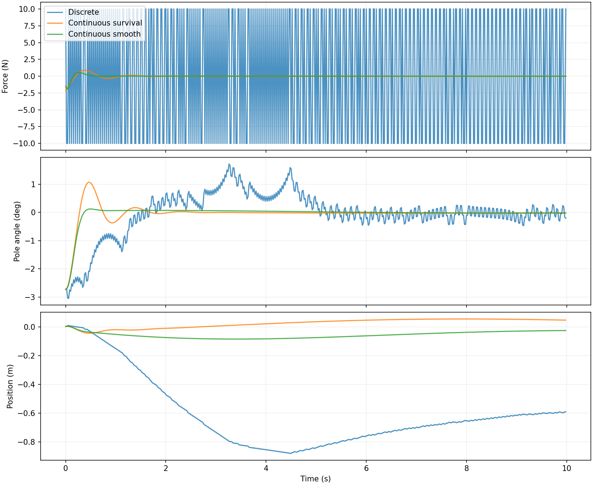
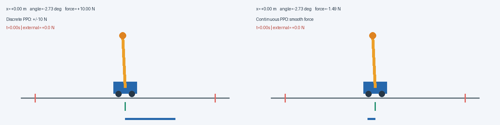

# 继承连续动作：用奖励表达平滑与用力代价

[系列目录](README.md) · [上一篇：只改动作表达：让 PPO 输出连续推力](02_只改动作空间让推力连续.md) · [下一篇：继承平滑控制：让小车回到目标位置并停稳](04_继承平滑控制实现目标位置停留.md)

> 本文是“小车倒立摆 PPO 逐步优化”系列的一篇。公式与参数对应现有实现，表格来自已保存的实验结果；动画为真实仿真轨迹。需要支持 LaTeX 的 Markdown 阅读器。图片与动图统一位于本系列的 `assets` 文件夹，请与文章一起保留。


## 本篇对应的独立代码

配套脚本：[03_smooth_reward_ppo.py](code/03_smooth_reward_ppo.py)。它内含本篇所需的环境、网络、PPO/GAE、训练、评估和动画逻辑，不导入原项目包。安装 [依赖](code/requirements.txt) 后，在项目根目录运行：

```bash
# 单文件从头训练，不需要先运行其他篇
python3 PPO优化系列/code/03_smooth_reward_ppo.py

# 加载本篇已发布模型，只做评估并生成动画
python3 PPO优化系列/code/03_smooth_reward_ppo.py --evaluate PPO优化系列/code/checkpoints/03_smooth_reward.npz
```

默认从头训练，与本篇原实验的初始化方式一致。默认结果位于脚本旁的 `outputs` 子目录；完整参数与模式说明见 [独立代码说明](code/README.md)。后文保留的 `python3 -m cartpole_pg...` 命令是原项目模块形式，单文件运行使用本节入口。

## 本篇只增加一种设计：在奖励里表达控制品质

上一篇已经把动作改为连续力，并且只凭存活奖励就得到较平滑的局部平衡。本篇保留这一动作空间，不再回到左右固定推力，也不增加位置目标或扰动训练。新增的是**控制品质奖励**：把倾角、位置、用力和力变化的代价显式写入目标。

| 继承项 | 本篇采用的配置 |
|---|---|
| 动力学与失败边界 | 与前两篇相同 |
| 动作 | 高斯潜变量 + tanh，控制力 ±10 N |
| 观测 | 位置、速度、倾角、角速度、上一控制力 |
| 学习机制 | PPO + GAE，64–64 独立 Actor/Critic |
| 学习率 / γ / λ | 3e−4 / .99 / .95，保持不变 |
| 唯一新主题 | 用状态、力和动作变化的惩罚描述期望控制行为 |

上一篇的五维观测已包含上一控制力，本篇真正开始在奖励中使用它。两个连续实验均从头训练，网络和预算相同；本篇没有加载存活奖励模型继续微调。这里的“继承”指完整保留前篇设计，两组结果对应独立训练实验。

继承的物理参数为：小车 1 kg、杆 0.1 kg、半杆长 0.5 m、重力 9.8 m/s²，均匀杆、无摩擦，20 ms 显式 Euler；失败条件为绝对位置超过 2.4 m 或倾角超过 12°。这些是各篇统一的仿真约定，不是学习出来的参数。

## 已继承的连续力接口

从第二篇开始，Actor 始终采样 $z=\mu(s)+\exp(\eta)\varepsilon$，执行 $u=10\tanh z$；评估使用 $10\tanh\mu$。PPO 通过 $\log\pi(u|s)=\log\mathcal N(z;\mu,\sigma^2)-\log[10(1-\tanh^2z)]$ 计算动作密度，保持潜变量样本、旧概率和优势固定。上一控制力在重置时设为零。之后增加奖励或训练扰动，都没有取消这套接口。

## 本篇继承的学习机制

Actor 根据观测产生动作分布，Critic 预测未来折扣回报。训练先固定旧策略采样，再计算优势，最后对同一批数据做有限轮 PPO 更新。优势 $\hat A_t>0$ 表示采样动作比该状态下的通常表现好，负值则相反；它不是动作的监督标签。

GAE 先计算 $\delta_t=r_t+\gamma b_tV(s_{t+1})-V(s_t)$，再反向递推 $\hat A_t=\delta_t+\gamma\lambda c_t\hat A_{t+1}$。$\lambda=0.95$；真正失败不自举，时间截断用重置前的最终状态自举，但两种回合结束都停止优势跨回合递推。

PPO 用 $\rho_t=\exp(\log\pi_{new}-\log\pi_{old})$ 和裁剪目标更新 Actor：

$$
L=\mathbb E[\min(\rho_t\hat A_t,\operatorname{clip}(\rho_t,0.8,1.2)\hat A_t)].
$$

裁剪削弱过大的有利方向更新激励，不是策略变化的严格硬约束。价值目标为旧价值加原始优势，Actor 的优势可标准化；旧概率、优势和价值目标都停止梯度。总损失包含价值回归与熵正则。

各篇默认保留独立 64–64 tanh Actor/Critic、8 个环境 × 256 步采样、4 轮更新、小批量 64、价值系数 0.5、熵系数 0.01、梯度范数上限 0.5。具体学习率、折扣与评估时长在各篇配置表中注明。

## 为什么满分回报无法区分两种控制品质

$r=1$ 时，一条存活 $T$ 步的轨迹折扣回报为 $(1-\gamma^T)/(1-\gamma)$。同样活 500 步，无论倾角小还是接近边界，回报相同。要让这些行为在优化目标中有区别，需要提供额外代价，而不能只希望网络“自然理解平滑”。

一般形式为：

$$
r=r_{alive}-\sum_i q_i(s_i/c_i)^2-q_u(u/U)^2-q_{\Delta u}((u-u_{prev})/U)^2.
$$

$c_i$ 是参考尺度，$q_i$ 才是相应无量纲代价权重。如果直接把米、弧度和牛顿平方相加，系数的含义会被数值单位掩盖。参考尺度不是状态归一化的唯一选择，两者也不必相等。

控制力惩罚与控制力变化惩罚不能互相替代。持续 +5 N 时，用力代价不为零，而相邻力变化为零；交替 ±1 N 时用力较小，但相邻变化为 2 N。连续任务中的 $u^2$ 能区分大小，离散固定幅值 ±10 N 的 $u^2$ 却恒为 100，无法区分左右动作。

## 上一动作为什么进入观测

如果两段历史到达相同四维物理状态，但上一推力分别是 −5 N 和 +5 N，那么现在施加 +5 N，产生的物理转移相同，动作变化代价却不同。只给网络四维状态，它无法完整判断当前奖励。因此用扩展状态：

$$
\bar s_t=[x_t,\dot x_t,\theta_t,\dot\theta_t,u_{t-1}],\qquad
\bar s_{t+1}=[s_{t+1},u_t].
$$

本篇无外部隐藏扰动，扩展观测消除了这一由奖励引入的历史依赖。回合重置时上一控制力设为 0；本步奖励先使用旧值计算，再更新缓存，不能先覆盖再计算，否则差值会总为零。

### 用奖励表达平滑，但不要先假设奖励是全部原因

连续版本比较了仅存活奖励与以下平滑奖励：

$$
r_t=1-0.15\left(\frac{\theta_{t+1}}{0.21}\right)^2
-0.05\left(\frac{x_{t+1}}{2.4}\right)^2
-0.01\left(\frac{u_t}{10}\right)^2
-0.05\left(\frac{u_t-u_{t-1}}{10}\right)^2.
$$

推力平方惩罚鼓励少用力，推力变化惩罚鼓励减少跳变。由于奖励依赖 $u_{t-1}$，观测加入上一控制力，输入尺度为 $[2.4,2,0.21,2,10]$。



**插图：相同初始状态的一条实际轨迹。** 蓝色离散策略反复切换 ±10 N；连续策略允许在零附近使用小力，倾角和小车位置也更平稳。

各连续版本训练 401,408 步。使用相同初始状态的 30 回合统一评估：

| 策略 | 种子 | 平均步数 | 倾角 RMS | 推力 RMS | 相邻推力变化 RMS |
|---|---:|---:|---:|---:|---:|
| 离散 PPO | 0 | 500 | 0.697° | 10.000 N | 17.542 N |
| 连续 PPO，仅存活奖励 | 0 | 500 | 0.229° | 0.145 N | 0.024 N |
| 连续 PPO，平滑奖励 | 0 | 500 | 0.213° | 0.125 N | 0.029 N |
| 连续 PPO，平滑奖励 | 1 | 500 | 0.215° | 0.128 N | 0.028 N |

相邻推力变化 RMS 先在各回合内计算，再在回合间平均，不包含重置跳变。

**连续动作已经带来显著改善。** 平滑奖励降低了种子 0 的倾角与推力 RMS，但推力变化 RMS 略高，不能声称所有指标都改善。两个连续版本采用同样的验证模型选择规则：先看存活长度，同分时偏好更低的力变化与用力程度，这也会影响最终结果。

离散与连续训练预算不同，以上比较说明最终控制行为有差异，不能证明连续 PPO 的样本效率一定更高。
## 如何读对照，而不把预期当成结果

前述对照图与并排动图中的连续一侧是本篇的平滑奖励策略；其中仅存活奖励的数值则来自上一篇独立运行。两种连续策略的比较比“离散对连续”更适合判断奖励变化，因为它们共享网络和 401,408 步训练预算。



**动图：继承连续力后的最终执行行为。** 这张图用于展示动作形态；要归因到奖励本身，应读同架构连续版本之间的表格。

本轮没有证明动作变化惩罚必然降低最终动作变化 RMS，也没有多种子齐备的奖励消融：仅存活奖励只有种子 0，平滑奖励有种子 0、1。模型选择也偏好较低用力和跳变，不能忽略这一共同影响。

普通二次代价会改变任务目标，不自动保持原奖励下的最优策略。权重过大会让策略宁愿少动作、甚至牺牲存活；平滑也不是越强越好，后续抗扰需要迅速施力。

## 复现与交接

```bash
OPENBLAS_NUM_THREADS=1 MPLCONFIGDIR=/tmp/cartpole-mpl python3 -m cartpole_pg.continuous --reward smooth --seed 0 --output results/continuous_seed0
```

数据见 [平滑奖励种子 0 指标](../results/continuous_seed0/metrics.json)。下一篇将明确继承这个模型：`results/continuous_seed0/policy.npz`，在其基础上微调位置目标。已具备的连续力、用力代价和动作变化代价全部保留。

## 理论来源与实现依据

- [PPO 原论文](https://arxiv.org/abs/1707.06347)：裁剪代理目标与多轮小批量更新的方法背景。
- [GAE 原论文](https://arxiv.org/abs/1506.02438)：用价值函数与多步残差估计优势的方法背景。
- [项目完整优化记录](../从抖动到抗扰：小车倒立摆PPO优化实录.md)：完整过程及数据入口。

本文模型参数、奖励与实验结论来自本项目实现和数据，不能从方法论文直接推出。有限回合成功不等于全局稳定性证明。

[系列目录](README.md) · [上一篇：只改动作表达：让 PPO 输出连续推力](02_只改动作空间让推力连续.md) · [下一篇：继承平滑控制：让小车回到目标位置并停稳](04_继承平滑控制实现目标位置停留.md)
