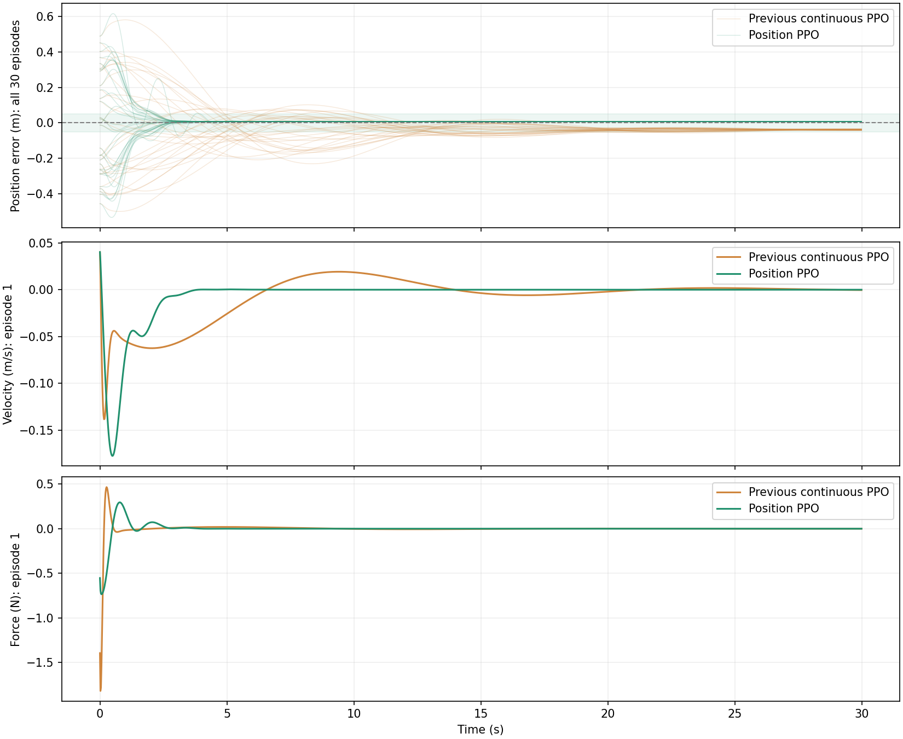
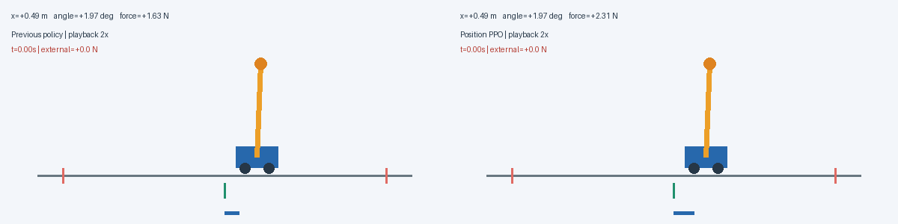

# 继承平滑控制：让小车回到目标位置并停稳

[系列目录](README.md) · [上一篇：继承连续动作：用奖励表达平滑与用力代价](03_在连续控制中加入平滑奖励.md) · [下一篇：继承位置控制：通过随机扰动训练加快恢复](05_继承位置控制学习随机扰动恢复.md)

> 本文是“小车倒立摆 PPO 逐步优化”系列的一篇。公式与参数对应现有实现，表格来自已保存的实验结果；动画为真实仿真轨迹。需要支持 LaTeX 的 Markdown 阅读器。图片与动图统一位于本系列的 `assets` 文件夹，请与文章一起保留。


## 本篇对应的独立代码

配套脚本：[04_position_ppo.py](code/04_position_ppo.py)。它内含本篇所需的环境、网络、PPO/GAE、训练、评估和动画逻辑，不导入原项目包。安装 [依赖](code/requirements.txt) 后，在项目根目录运行：

```bash
# 单文件从头训练，不需要先运行其他篇
python3 PPO优化系列/code/04_position_ppo.py

# 加载本篇已发布模型，只做评估并生成动画
python3 PPO优化系列/code/04_position_ppo.py --evaluate PPO优化系列/code/checkpoints/04_position.npz
```

要复现本篇实际的前篇模型微调起点，显式传入 `--initial`：

```bash
python3 PPO优化系列/code/04_position_ppo.py --initial PPO优化系列/code/checkpoints/03_smooth_reward.npz
```

未提供初始模型时仍可从零运行，但不等同于本文的微调实验。默认结果位于脚本旁的 `outputs` 子目录；完整参数与模式说明见 [独立代码说明](code/README.md)。后文保留的 `python3 -m cartpole_pg...` 命令是原项目模块形式，单文件运行使用本节入口。

## 本篇只解决一个新目标：回位并停稳

上一篇已获得连续、低幅值的控制力，并且考虑角度、用力和动作变化。本篇从其种子 0 检查点继续训练，**保留连续动作和两个控制代价**，把位置控制从轻微偏好提升为明确的目标调节任务。

| 项目 | 继承 / 本篇变化 |
|---|---|
| 连续力与概率修正 | 全部继承，不更换策略分布 |
| 用力与力变化代价 | 继承原权重 .01、.05 |
| PPO、GAE、网络 | 继承；载入 Actor/Critic/logstd，重置 Adam 动量 |
| 新目标 | 指定位置误差与速度趋近零 |
| 配套训练设置 | 扩大初始位置分布、γ 改为 .995、学习率改为 1e−4 |
| 配套评估设置 | 训练仍截断 10 秒，评估扩展到 30 秒 |

这是围绕“位置停留”的一组配套设计，不是只改一个参数的严格消融。尚未加入训练中的外力扰动。

继承的物理参数为：小车 1 kg、杆 0.1 kg、半杆长 0.5 m、重力 9.8 m/s²，均匀杆、无摩擦，20 ms 显式 Euler；失败条件为绝对位置超过 2.4 m 或倾角超过 12°。这些是各篇统一的仿真约定，不是学习出来的参数。

## 已继承的连续力接口

从第二篇开始，Actor 始终采样 $z=\mu(s)+\exp(\eta)\varepsilon$，执行 $u=10\tanh z$；评估使用 $10\tanh\mu$。PPO 通过 $\log\pi(u|s)=\log\mathcal N(z;\mu,\sigma^2)-\log[10(1-\tanh^2z)]$ 计算动作密度，保持潜变量样本、旧概率和优势固定。上一控制力在重置时设为零。之后增加奖励或训练扰动，都没有取消这套接口。

## 本篇继承的学习机制

Actor 根据观测产生动作分布，Critic 预测未来折扣回报。训练先固定旧策略采样，再计算优势，最后对同一批数据做有限轮 PPO 更新。优势 $\hat A_t>0$ 表示采样动作比该状态下的通常表现好，负值则相反；它不是动作的监督标签。

GAE 先计算 $\delta_t=r_t+\gamma b_tV(s_{t+1})-V(s_t)$，再反向递推 $\hat A_t=\delta_t+\gamma\lambda c_t\hat A_{t+1}$。$\lambda=0.95$；真正失败不自举，时间截断用重置前的最终状态自举，但两种回合结束都停止优势跨回合递推。

PPO 用 $\rho_t=\exp(\log\pi_{new}-\log\pi_{old})$ 和裁剪目标更新 Actor：

$$
L=\mathbb E[\min(\rho_t\hat A_t,\operatorname{clip}(\rho_t,0.8,1.2)\hat A_t)].
$$

裁剪削弱过大的有利方向更新激励，不是策略变化的严格硬约束。价值目标为旧价值加原始优势，Actor 的优势可标准化；旧概率、优势和价值目标都停止梯度。总损失包含价值回归与熵正则。

各篇默认保留独立 64–64 tanh Actor/Critic、8 个环境 × 256 步采样、4 轮更新、小批量 64、价值系数 0.5、熵系数 0.01、梯度范数上限 0.5。具体学习率、折扣与评估时长在各篇配置表中注明。

## 从平衡到位置调节：为什么需要四个运动状态

$\theta\approx0$ 只表示杆近似直立，不能推出 $x=x_{target}$。理想无摩擦系统里，一个小车可以在偏离目标的地方直立，甚至以非零速度移动。目标应当是：

$$
[x-x_{target},\dot x,\theta,\dot\theta]\to[0,0,0,0].
$$

位置误差给出距离目标多远，速度告诉策略是否需要刹车；倾角和角速度决定这次移动是否会损害平衡。小车为了推动摆杆产生所需运动，可能短暂先离开目标，这使局部贪心地减小位置误差并不可靠。

相对位置观测使网络在轨道内部能够使用同一种误差反馈。轨道边界却由绝对位置定义，因此平移不变性不是全局成立的。本轮只验证固定目标 0 m，不能凭输入换成误差就声称任意位置和动态目标均能跟踪。

## 第三阶段：把“在附近平衡”改成“回到目标并停下来”

### 到达目标不等于停在目标

只惩罚位置误差，策略可能反复穿过目标；只惩罚速度，又可能不愿返回目标。需要同时表示两个目标：

$$
e_x=x-x_{\mathrm{target}},\qquad e_x\to0,\quad\dot x\to0.
$$

位置版本将观测第一维替换为 $e_x$，其余保持不变。默认目标为 0 m。位置观测归一化尺度仍为 2.4 m，奖励中的位置尺度则为 0.5 m，两者用途不同。

训练初始位置半径在前 40% 预算从 0.1 m 扩大到 0.5 m，以提供真实的回位经验。初始速度、倾角、角速度仍在 ±0.05 内随机取值。

### 位置、速度与平衡的权衡

位置奖励为：

$$
\begin{aligned}
r_t={}&1-0.15(\theta_{t+1}/0.21)^2-0.01(\dot\theta_{t+1}/2)^2\\
&-0.45\tanh^2(e_{x,t+1}/0.5)
-0.15\tanh^2(\dot x_{t+1}/0.5)\\
&-0.01(u_t/10)^2-0.05((u_t-u_{t-1})/10)^2.
\end{aligned}
$$

位置和速度惩罚用 tanh 饱和，防止远离目标时二次位置代价无限增大。它不是保证安全的机制，其他状态代价仍可能很大，也不能据此证明最优策略必然存活。

这些普通惩罚改变了优化目标，不是自动保持原任务最优策略的“无害塑形”。速度代价过大可能回位慢，过小可能冲过目标；减少推力变化的要求也可能限制快速纠正。这些权重需要用实际轨迹判断。

### 延长评估，观察是否缓慢漂移

训练每回合仍截断于 500 步，使用持续任务自举。验证和最终评估延长到 1500 步、30 秒。模型先按验证存活率选择，再最小化：

$$
\text{最后 5 秒位置 RMS}+0.2\times\text{最后 5 秒速度 RMS}.
$$

这里是带单位的工程评分，不是无量纲理论指标。

位置阶段在同一个连续种子 0 模型上，用两个微调种子各继续训练 401,408 步。Adam 动量重新初始化；它们不是从头独立训练的两个实验。



**插图：目标为 0 m 的实际对照。** 上图展示种子 0 的全部 30 回合位置误差，下方展示第一个回合的速度与控制力。绿色区域为位置 ±5 cm，速度条件需另外检查。

| 策略 | 评估/微调种子 | 30 秒完整存活 | 最后 5 秒位置 RMS | 速度 RMS | 平均安定时间 |
|---|---:|---:|---:|---:|---:|
| 旧连续策略 | 0 | 30/30 | 3.876 cm | 0.159 cm/s | 16.430 s |
| 位置 PPO | 0 | 30/30 | 0.716 cm | 约 0 cm/s | 2.165 s |
| 旧连续策略 | 1 | 30/30 | 3.857 cm | 0.139 cm/s | 15.561 s |
| 位置 PPO | 1 | 30/30 | 0.680 cm | 0.115 cm/s | 7.785 s |

安定要求同时满足 $|e_x|\le0.05$ m 与 $|\dot x|\le0.05$ m/s，之后一直保持至 30 秒结束，且至少持续 1 秒。两组均有 30/30 回合满足。

种子 0 回位较快，但全回合倾角 RMS 从 0.139° 增加至 0.450°，用力也增加。种子 1 回位更慢。学习到的控制规律存在差异，不能只展示最好的一条轨迹。



**动图：旧连续策略与位置策略回位对照。** 从种子 0 的 30 个已保存评估回合中，选择初始位置绝对值最大的一个，两侧使用相同初始状态。展示前 20 秒，以 **2 倍速**播放，画面显示的是实际仿真时间。它用于清楚展示回位过程，不代表平均回合；统计结论仍以上表为准。

约 7 mm 的残差也说明：加入位置惩罚并不等于严格零误差调节器。本项目没有积分误差状态或稳定性证明。
## 位置奖励在小误差区和大误差区做了什么

当 $|e|\ll c$ 时，$\tanh(e/c)\approx e/c$，位置代价近似 $q_x e^2/c^2$，具有二次惩罚形状；当误差很大时，代价接近 $q_x$，不会无限增长。代价对误差的导数为：

$$
\frac{d}{de}\left[q_x\tanh^2(e/c)\right]
=\frac{2q_x}{c}\tanh(e/c)\left[1-\tanh^2(e/c)\right].
$$

该导数用于理解目标形状，PPO 不直接通过环境或奖励对动作求导。大误差区饱和也意味着不同的大误差不易被奖励区分，必须结合初始状态课程和实际轨迹检查。

本篇 $\gamma=.995$，常用的几何权重尺度 $1/(1-\gamma)$ 约为 200 步、4 秒；这只是折扣权重尺度，不是未来在 4 秒后被截断。延长评估用于发现缓慢漂移，不会自动让训练使用 30 秒蒙特卡洛回报。

## 位置误差为什么没有严格归零

策略是有限参数网络，用随机交互和近似优势优化有限预算的期望回报，并无硬性的 $e_x=0$ 约束。小误差代价很小、控制代价和其他目标同时存在，模型选择也只看有限回合，因此出现非零平衡偏差并不奇怪。

若以后加入积分误差观测，可以使持续偏差积累，但需要重新训练、限幅并检查过冲；这不是本篇已经实现的能力。当前约 7 mm 是实测残差，而不是保证误差上界。

## 复现、模型选择和下一篇起点

```bash
OPENBLAS_NUM_THREADS=1 MPLCONFIGDIR=/tmp/cartpole-mpl python3 -m cartpole_pg.position --seed 0 --initial results/continuous_seed0/policy.npz --output results/position_seed0
```

新增训练 401,408 步，验证使用种子 10000 的 10 个回合，最终评估种子 20000 的 30 回合；种子 1 对应不同微调和评估种子，但仍从同一个连续种子 0 模型继承。前两篇分别从头初始化，不要把各篇文章的逻辑接续误写成全部权重都接续。

实现见 [位置控制](../cartpole_pg/position.py)，逐回合数据见 [评估记录](../results/position_seed0/episodes.json)。下一篇以本篇种子 0 的验证最佳 `policy.npz` 为起点，保留位置奖励，只改变训练中是否经历外力脉冲以及模型选择的重点。

## 理论来源与实现依据

- [PPO 原论文](https://arxiv.org/abs/1707.06347)：裁剪代理目标与多轮小批量更新的方法背景。
- [GAE 原论文](https://arxiv.org/abs/1506.02438)：用价值函数与多步残差估计优势的方法背景。
- [项目完整优化记录](../从抖动到抗扰：小车倒立摆PPO优化实录.md)：完整过程及数据入口。

本文模型参数、奖励与实验结论来自本项目实现和数据，不能从方法论文直接推出。有限回合成功不等于全局稳定性证明。

[系列目录](README.md) · [上一篇：继承连续动作：用奖励表达平滑与用力代价](03_在连续控制中加入平滑奖励.md) · [下一篇：继承位置控制：通过随机扰动训练加快恢复](05_继承位置控制学习随机扰动恢复.md)
