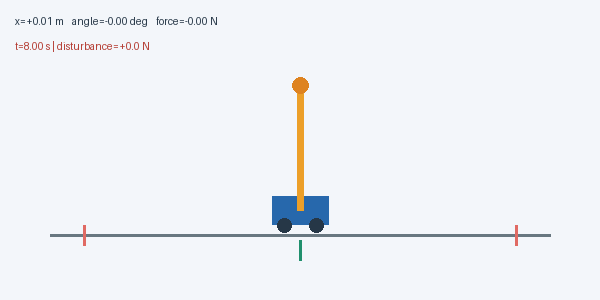
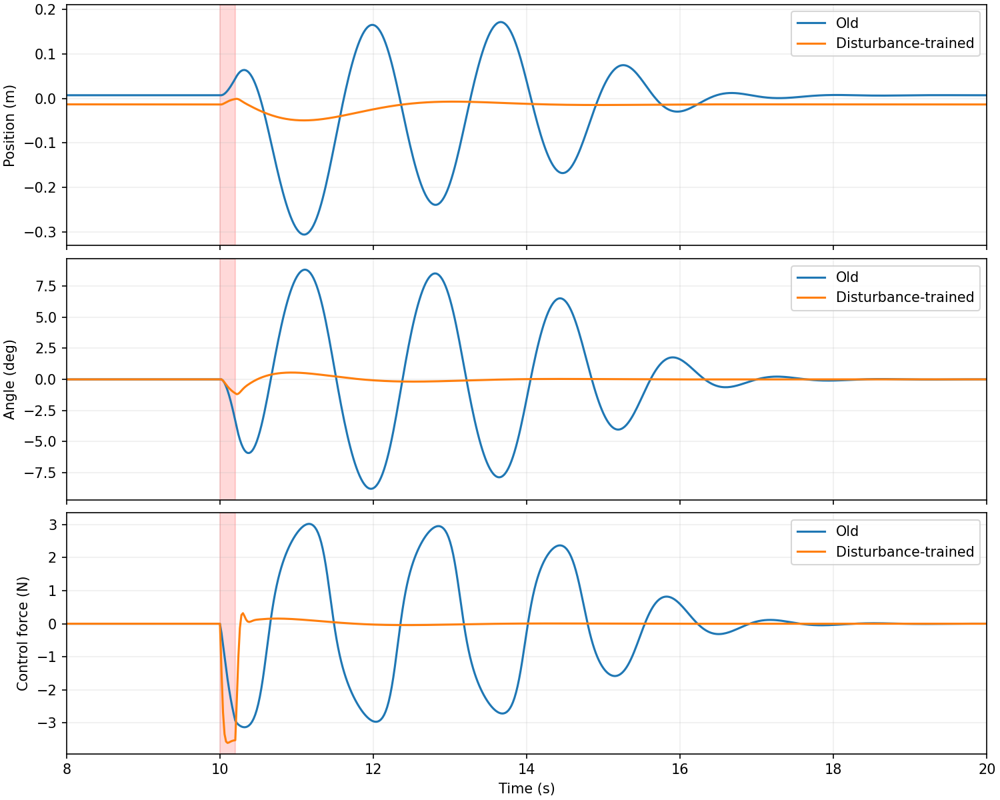
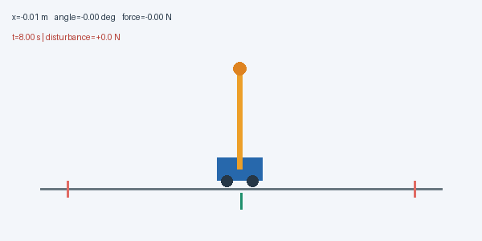
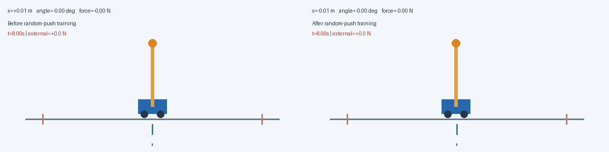
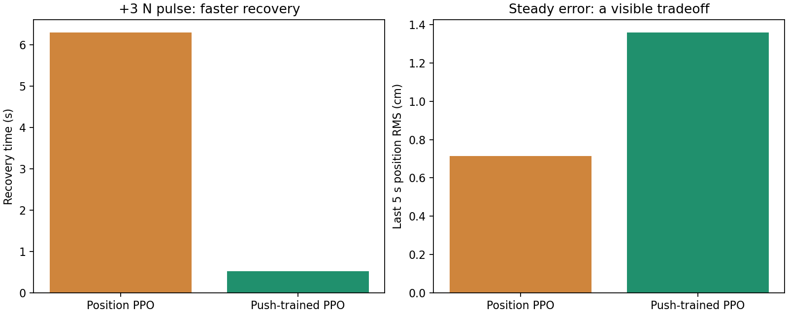
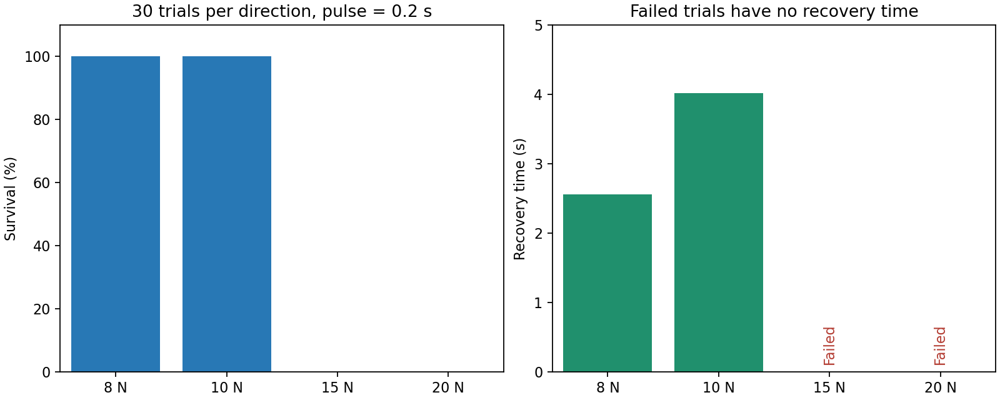
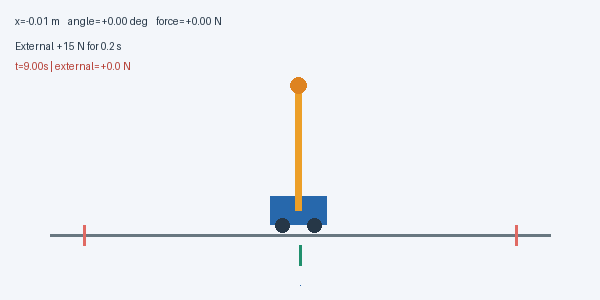

# 继承位置控制：通过随机扰动训练加快恢复

[系列目录](README.md) · [上一篇：继承平滑控制：让小车回到目标位置并停稳](04_继承平滑控制实现目标位置停留.md) · 本篇为当前系列终篇

> 本文是“小车倒立摆 PPO 逐步优化”系列的一篇。公式与参数对应现有实现，表格来自已保存的实验结果；动画为真实仿真轨迹。需要支持 LaTeX 的 Markdown 阅读器。图片与动图统一位于本系列的 `assets` 文件夹，请与文章一起保留。


## 本篇对应的独立代码

配套脚本：[05_robust_ppo.py](code/05_robust_ppo.py)。它内含本篇所需的环境、网络、PPO/GAE、训练、评估和动画逻辑，不导入原项目包。安装 [依赖](code/requirements.txt) 后，在项目根目录运行：

```bash
# 单文件从头训练，不需要先运行其他篇
python3 PPO优化系列/code/05_robust_ppo.py

# 加载本篇已发布模型，只做评估并生成动画
python3 PPO优化系列/code/05_robust_ppo.py --evaluate PPO优化系列/code/checkpoints/05_robust.npz
```

要复现本篇实际的前篇模型微调起点，显式传入 `--initial`：

```bash
python3 PPO优化系列/code/05_robust_ppo.py --initial PPO优化系列/code/checkpoints/04_position.npz
```

未提供初始模型时仍可从零运行，但不等同于本文的微调实验。默认结果位于脚本旁的 `outputs` 子目录；完整参数与模式说明见 [独立代码说明](code/README.md)。后文保留的 `python3 -m cartpole_pg...` 命令是原项目模块形式，单文件运行使用本节入口。

## 本篇只增加一项能力：学习受推后的恢复

上一篇已经继承连续力和平滑代价，学会回到目标并停稳。本篇从其种子 0 模型继续微调：**目标仍是 0 m，位置奖励的全部权重、连续动作、网络和力上限均保持不变**。新增的是随机外力训练；验证也改为优先评价受推后的存活与恢复。

| 继承项 | 本篇配置 |
|---|---|
| 初始模型 | `results/position_seed0/policy.npz` |
| 连续动作 | 高斯 + tanh，执行器 ±10 N |
| 位置、速度、角度、用力、力变化代价 | 全部沿用位置篇 |
| 学习率 / γ / λ | 1e−4 / .995 / .95，沿用位置篇 |
| 训练新增 | 随机方向、幅值、开始时间和时长的单次脉冲 |
| 训练后评估 | 冻结模型，比较固定脉冲，再增加外力强度 |

本篇先诊断原模型的问题，再描述同一改进的训练和测试。后半部分强外力实验只是能力边界检查，没有引入第二项训练改进。

继承的物理参数为：小车 1 kg、杆 0.1 kg、半杆长 0.5 m、重力 9.8 m/s²，均匀杆、无摩擦，20 ms 显式 Euler；失败条件为绝对位置超过 2.4 m 或倾角超过 12°。这些是各篇统一的仿真约定，不是学习出来的参数。

## 已继承的连续力接口

从第二篇开始，Actor 始终采样 $z=\mu(s)+\exp(\eta)\varepsilon$，执行 $u=10\tanh z$；评估使用 $10\tanh\mu$。PPO 通过 $\log\pi(u|s)=\log\mathcal N(z;\mu,\sigma^2)-\log[10(1-\tanh^2z)]$ 计算动作密度，保持潜变量样本、旧概率和优势固定。上一控制力在重置时设为零。之后增加奖励或训练扰动，都没有取消这套接口。

## 完整保留的位置控制奖励

为了明确“继承”包含哪些目标，本篇仍使用第四篇的整个奖励，而非重新退回存活奖励。位置目标固定为零，记 $e_x=x-x_{target}$，则：

$$
\begin{aligned}
r_t={}&1-0.15(\theta_{t+1}/0.21)^2-0.01(\dot\theta_{t+1}/2)^2\\
&-0.45\tanh^2(e_{x,t+1}/0.5)-0.15\tanh^2(\dot x_{t+1}/0.5)\\
&-0.01(u_t/10)^2-0.05((u_t-u_{t-1})/10)^2.
\end{aligned}
$$

输入依然是 $[e_x,\dot x,\theta,\dot\theta,u_{t-1}]$，按 $[2.4,2,0.21,2,10]$ 缩放。控制器既要平衡和回位，又保留少用力、少跳变的诉求；扰动进入实际动力学，不改变奖励计算中 $u_t$ 的执行器含义。

## 本篇继承的学习机制

Actor 根据观测产生动作分布，Critic 预测未来折扣回报。训练先固定旧策略采样，再计算优势，最后对同一批数据做有限轮 PPO 更新。优势 $\hat A_t>0$ 表示采样动作比该状态下的通常表现好，负值则相反；它不是动作的监督标签。

GAE 先计算 $\delta_t=r_t+\gamma b_tV(s_{t+1})-V(s_t)$，再反向递推 $\hat A_t=\delta_t+\gamma\lambda c_t\hat A_{t+1}$。$\lambda=0.95$；真正失败不自举，时间截断用重置前的最终状态自举，但两种回合结束都停止优势跨回合递推。

PPO 用 $\rho_t=\exp(\log\pi_{new}-\log\pi_{old})$ 和裁剪目标更新 Actor：

$$
L=\mathbb E[\min(\rho_t\hat A_t,\operatorname{clip}(\rho_t,0.8,1.2)\hat A_t)].
$$

裁剪削弱过大的有利方向更新激励，不是策略变化的严格硬约束。价值目标为旧价值加原始优势，Actor 的优势可标准化；旧概率、优势和价值目标都停止梯度。总损失包含价值回归与熵正则。

各篇默认保留独立 64–64 tanh Actor/Critic、8 个环境 × 256 步采样、4 轮更新、小批量 64、价值系数 0.5、熵系数 0.01、梯度范数上限 0.5。具体学习率、折扣与评估时长在各篇配置表中注明。

## 外力进入哪里，为什么不让策略直接看到它

实际水平力为 $f=u+d$，其中 $u$ 是策略控制力，$d$ 是独立外力。策略仍只观测位置误差、速度、角度、角速度和上一次自身控制力。把 $d$ 塞进“上一控制力”会改变观测含义，也可能让策略获得实验中不应直接知道的扰动信息。

保持 $|u|\le10$ N，但不把 $u+d$ 再裁剪到 ±10 N，否则外部推力会被错误限幅。外力可比执行器力大，但能否恢复取决于时长、时刻、状态和非线性动力学，不能只比较两者最大值。

控制器只能通过运动状态的变化作出反馈，既没有重新训练后的在线参数更新，也没有临时人工接管。

## 第四阶段：推一下，才能看见无扰动训练的盲区

先冻结位置种子 0 模型，在第 10 秒施加外力：

$$
d(t)=\begin{cases}D,&10\le t<10.2\ \mathrm s,\\0,&\text{其他时刻}.\end{cases}
$$

单条实际轨迹中，+3 N、持续 0.2 秒的脉冲让小车最大偏离约 0.306 m，最大倾角约 8.83°，恢复约需 6.3 秒；+5 N 则超过 12° 失败阈值。



**插图：未做扰动微调时，+3 N 推力后的真实恢复过程。** GIF 展示仿真 8～20 秒，红色箭头仅在 0.2 秒脉冲期间出现。

为什么静态表现良好却恢复慢？一个合理解释是：无扰动训练访问的状态，与突然受推后的状态分布不同。后者同时包含较大的速度、倾角和角速度，原策略在这些状态上的动作选择未被充分优化。

这是对现象的解释，不是对网络内部决策机制的直接证明。原策略并非没有恢复能力，只是当前目标和训练经历没有充分偏向快速恢复。

### 扶正与回位，应分别评价

扰动评估使用两个指标：

- 扶正时间：倾角进入 ±1°，连续保持 0.5 秒。
- 回位停稳时间：位置误差进入 ±5 cm、速度进入 ±5 cm/s，连续保持 2 秒。

时间均从脉冲结束的 10.2 秒开始算，报告满足区间的**起点**。例如恢复时间 0.52 秒，意味着约在 10.72 秒开始连续满足条件，而不是确认完 2 秒后的 12.72 秒。

当前实现使用步后状态，最早值为 0.02 秒；无扰动对照或始终在容差内的轻微扰动，得到这个值不能理解为“20 ms 完成了全部纠正”。扰动恢复判据也不同于上一节“持续至评估结束”的安定判据。

## 第五阶段：奖励不变，把受推状态加入训练

第一轮没有同时修改奖励，而是从位置种子 0 模型继续训练，保持相同的网络、观测、力限制、奖励和微调超参数。

| 随机脉冲参数 | 配置 |
|---|---|
| 每回合脉冲数 | 1 |
| 开始时刻 | 第 80～349 步，约 1.6～6.98 秒 |
| 持续时间 | 5～15 步，0.1～0.3 秒 |
| 方向 | 左右随机 |
| 幅值 | 1 N 到当前上限，均匀采样 |
| 上限课程 | 前半训练从 1 N 增至 3 N |
| 初始位置范围 | 目标 ±0.5 m |
| 新增预算 | 401,408 交互步 |

每个回合的脉冲参数在重置时确定；课程上限对之后重置的回合生效。策略不直接获得外力信息，上一控制力也不包含外力。

需要注意：外力有隐藏的开始与结束时间，仅凭当前物理状态和上一控制力，观测不一定构成严格的马尔可夫状态。更准确地说，这是带隐藏扰动过程的控制问题；当前前馈网络依靠运动状态反馈取得了经验效果。若研究更复杂的持续扰动，可以考虑历史观测、循环策略或扰动估计器。

### 模型选择也改为关注扰动恢复

验证集使用无扰动、+3 N、−3 N，各 8 回合，脉冲第 10 秒施加，持续 0.2 秒，运行到 30 秒。选择规则为：先最大化平均存活率，再最小化恢复代价。

成功存活并恢复的回合使用实际恢复时间，失败或未恢复的回合记作 20 秒代价。初始模型也参加选择，避免最后一次更新较差时覆盖已有能力。

训练中的扰动时刻与持续时间随机，验证则固定。这是便于比较的工程选择，也限定了最终结论的范围。

### 独立评估：速度、偏移和失败率一起看

最终评估使用另一组 30 个初始状态，分别施加 0、±1、±3、±5 N，新旧策略使用相同状态和扰动。每种强度每个方向均有 30 回合。



**插图：同一 +3 N 脉冲下的实际轨迹。** 阴影标出扰动时段。微调后的控制器更早抑制倾角与位置偏移，控制力的时序也随之改变；没有加后处理滤波器。

| 外力 | 旧位置 PPO 存活 | 旧恢复均值 | 扰动微调 PPO 存活 | 新恢复均值 |
|---|---:|---:|---:|---:|
| +3 N | 29/30 | 6.297 s | 30/30 | 0.520 s |
| −3 N | 29/30 | 5.240 s | 30/30 | 0.520 s |
| +5 N | 0/30 | 无成功恢复 | 30/30 | 2.140 s |
| −5 N | 0/30 | 无成功恢复 | 30/30 | 2.120 s |

旧模型有一个初始状态在第 10 秒前就失败；无扰动对照也为 29/30，因此不能把这次失败归因于 ±3 N 推力。该批量评估与前一阶段的逐回合评估使用不同的随机数消耗方式，初始样本集不同，不能把之前的 30/30 直接搬到这里。

恢复均值只统计**存活且恢复**的回合，失败与未恢复数量同时展示。最大位置/倾角统计从第 10 秒开始；提前失败回合没有该指标，也不会被填成零。

+3 N 下，最大位置偏差的回合均值从约 0.306 m 降至 0.049 m，最大倾角从约 8.83° 降至 1.19°。改善不仅是更快返回，也包括更早抑制扰动造成的偏离。



**插图：扰动微调后，同样 +3 N、0.2 秒脉冲的实际动画。** 与本篇训练前动画采用相同初始状态和时间窗口。



**动图：同一 +3 N 脉冲的同步对照。** 左侧为位置策略，右侧为扰动微调后的策略，展示仿真 8～18 秒。红色箭头在第 10 秒出现并持续 0.2 秒。两侧同时播放更容易看到：右侧既限制了倾角增长，也更早停止位置偏移。

### 改善有代价，不能把一个指标当成全部目标



**插图：实际指标的取舍。** +3 N 扰动恢复约快了一个数量级，但最后 5 秒位置 RMS 从约 0.716 cm 增加到 1.359 cm。

这轮实验同时增加了扰动训练经验和恢复导向的模型选择，因此不能把全部改善严格归因于单一因素。它没有增加网络尺寸、控制力上限或额外控制器，但也没有做等预算的“继续无扰动训练”对照。

若要进一步兼顾速度与精度，可以在后续实验中把稳态误差纳入模型选择，或者设置分阶段目标；当前结果不足以说明误差变大是抗扰性能提升的必然代价。

## 第六阶段：更强的推力，恢复能力在哪里开始失效？

训练只覆盖最高 3 N 的随机脉冲。随后冻结同一个模型，不修改参数、不扩大执行器上限，测试更大外力。每次仍在第 10 秒施加，持续 0.2 秒，每个方向评估 30 回合。



**插图：正向强外力评估。** 失败回合没有恢复时间，图中写明 Failed，而不是画成 0 秒；反向测试得到相近结果。

| 外力 | 两方向各自存活 | 恢复均值（正 / 负） | 最大倾角均值（正 / 负） |
|---|---:|---:|---:|
| ±8 N | 30/30 | 2.56 / 2.54 s | 5.88° / 5.81° |
| ±10 N | 30/30 | 4.02 / 4.02 s | 9.91° / 9.80° |
| ±15 N | 0/30 | 无成功恢复 | 越过 12° 阈值 |
| ±20 N | 0/30 | 无成功恢复 | 越过 12° 阈值 |


**动图：+10 N、持续 0.2 秒的强推力。** 展示仿真 9～19 秒，相比 +3 N，小车偏离更大、倾角更大，恢复也更慢。当前模型仍可回到停留范围；动画中的一个成功回合不能替代 30 回合统计。



**动图：+15 N 脉冲下的失败过程。** 从第 9 秒开始展示，在最终积分步超过 ±12° 阈值后停止。结尾将最后记录的观测画面停留约 2 秒并标注失败，便于阅读；这段停留不是额外仿真时间，也不是摆杆落地动画。

可以说：**在当前脉冲时长、施加时刻、初始状态和失败边界下，10 N 测试通过，15 N 测试失败。** 不能据此宣布精确极限是 10 N，也不能推出任意小于 10 N 的扰动都安全。

外力大小不是唯一因素。脉冲冲量为：

$$
\mathcal I=\int d(t)\,dt=D\Delta T.
$$

例如 10 N 持续 0.2 秒的冲量是 2 N·s。改变持续时间和当时的系统状态，会改变扰动后果；冲量相同的两种波形也未必同样难控制。

大力失败时，执行器饱和、非线性状态变化、训练覆盖范围和 ±12° 任务边界都可能参与作用。本实验没有逐一分离这些原因，不能简单归结为“扰动力比控制力大，所以必定失败”。
## 随机扰动为什么可能改善，而不只是增加训练步数

记无扰动下策略访问的状态分布为 $d_0^\pi$，训练扰动分布为 $p(d)$。加入随机外力后，优化的是与该扰动分布相结合的期望表现：

$$
J(\vartheta)=\mathbb E_{d\sim p(d),\tau\sim\pi_\vartheta,P_d}\left[\sum_t\gamma^t r_t\right].
$$

奖励可以不变，采样分布却改变了。受推后的较大速度、角速度和偏角更频繁进入训练，PPO 因而有机会调整这些状态下的反馈行为。这里只是在数学上表述训练目标的变化，不代表项目计算了状态分布的显式密度。

本实验没有等预算无扰动微调对照，并且更改了模型选择标准，故不能把所有改善严格归因于扰动数据。训练只覆盖最高 3 N，±5、±10 N 的成功属于这次测试中的外推结果，不是全范围鲁棒性的证明。

## 恢复快了，为什么还会偏离目标约 1.4 cm？

本篇的位置奖励继承前篇，不意味着所有指标都会保持前篇水平。验证只要求进入 ±5 cm、速度进入 ±5 cm/s，并优先看恢复代价；停在 1.4 cm 与 0 cm 都满足这个容差。目标附近的位置惩罚约为 $0.45(e/0.5)^2$，在 1.4 cm 时每步只有约 0.00035，精细校正信号较弱。

这是对结果的合理解释，不是已经完成的原因消融。本篇尚未加入积分控制、细精度奖励或稳态精度优先选择。后续可先检查候选模型的稳态表现，再决定是否细调奖励，避免同时改多个因素而失去判断依据。

## 复现与数据口径

```bash
OPENBLAS_NUM_THREADS=1 MPLCONFIGDIR=/tmp/cartpole-mpl python3 -m cartpole_pg.robust --seed 0 --output results/robust_seed0
OPENBLAS_NUM_THREADS=1 MPLCONFIGDIR=/tmp/cartpole-mpl python3 -m cartpole_pg.disturbance --checkpoint results/robust_seed0/policy.npz --output results/robust_animation
python3 -m cartpole_pg.disturbance --checkpoint results/robust_seed0/policy.npz --output results/strong_disturbance --forces 8 -8 10 -10 15 -15 20 -20 5 3 0
```

最后一个命令生成单条动画；30 回合强外力统计来自 `robust.evaluate_pushes`，保存在 [批量数据](../results/strong_disturbance/batch_metrics.json)。[新旧扰动指标](../results/robust_seed0/metrics.json) 和 [新模型逐回合记录](../results/robust_seed0/new_trials.json) 可以核对失败与条件恢复均值。

本轮只有一个扰动微调种子。脉冲第 10 秒施加时，大部分初始状态已收敛到相近平衡点，因此 30 个初始状态并不等于 30 个差异很大的受推状态。持续偏置、重复外力、随机测试时刻、摩擦和延迟都未系统评估。

控制精度与抗扰恢复是不同目标。系列当前的结论是：逐步继承动作表达、控制品质和位置调节后，加入随机推力经验及恢复导向选择，能在本次仿真中显著改善脉冲后的恢复；它仍是一套需要继续验证的学习控制器。

## 理论来源与实现依据

- [PPO 原论文](https://arxiv.org/abs/1707.06347)：裁剪代理目标与多轮小批量更新的方法背景。
- [GAE 原论文](https://arxiv.org/abs/1506.02438)：用价值函数与多步残差估计优势的方法背景。
- [项目完整优化记录](../从抖动到抗扰：小车倒立摆PPO优化实录.md)：完整过程及数据入口。

本文模型参数、奖励与实验结论来自本项目实现和数据，不能从方法论文直接推出。有限回合成功不等于全局稳定性证明。

[系列目录](README.md) · [上一篇：继承平滑控制：让小车回到目标位置并停稳](04_继承平滑控制实现目标位置停留.md) · 本篇为当前系列终篇
